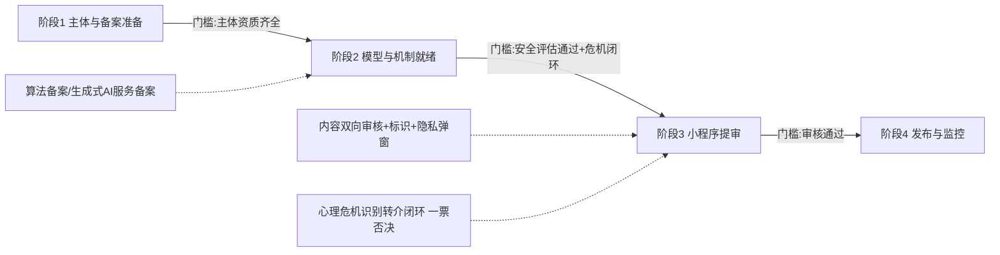

# 备案材料与流程清单（情感陪聊小程序）

> 适用：面向公众提供生成式对话的小程序。文中法规名称、适用范围与条款以最新官方要求为准，需向属地网信部门确认；本文为准备清单，不构成法律意见。

## 一、法规与义务对照表

| 法规 | 是否适用 | 本项目需履行的义务 |
|---|---|---|
| 《生成式人工智能服务管理暂行办法》 | 适用（面向公众提供生成式对话） | 履行生成式AI服务备案；训练语料来源合法、不侵犯知识产权；建立内容标识、投诉举报、用户协议机制；开展安全评估并配合监管。适用范围/条款以最新官方要求为准、需向属地网信确认。 |
| 《互联网信息服务算法推荐管理规定》 | 适用/需确认（若含个性化分发或推荐即适用） | 办理算法备案并公示算法基本原理；保障用户选择与关闭个性化推荐的权利；配合算法安全评估。是否纳入以最新官方要求为准、需向属地网信确认。 |
| 《互联网信息服务深度合成管理规定》 | 适用（文本生成属深度合成） | 对生成内容添加显式+隐式标识；在用户协议中告知深度合成服务；履行深度合成/算法备案与安全评估。条款以最新官方要求为准、需向属地网信确认。 |
| 《中华人民共和国个人信息保护法》 | 适用（收集对话、昵称、手机号等） | 隐私政策告知并取得同意；遵循最小必要；敏感信息单独同意；响应查阅、复制、删除等用户权利；约束委托处理。以最新官方要求为准、需向属地网信确认。 |
| 《未成年人网络保护条例》 | 适用（面向公众，含未成年用户） | 建立未成年人保护/防沉迷机制；不满14周岁需监护人同意；内容适配与个人信息特别保护。以最新官方要求为准、需向属地网信确认。 |

## 二、备案材料清单

| 材料 | 用途 | 负责方 | 前置依赖 |
|---|---|---|---|
| 主体资质（营业执照、法人证件） | 备案主体与小程序认证 | 产品/法务 | 企业主体注册 |
| 算法备案信息（算法原理、流程图、负责人） | 算法备案系统填报 | 算法团队 | 模型方案定稿 |
| 生成式AI服务备案材料（备案表、服务说明） | 服务备案 | 法务/产品 | 算法备案、主体资质 |
| 安全评估报告（自评估或第三方） | 证明安全可控 | 安全/法务 | 语料与审核机制就绪 |
| 语料来源说明（来源清单、版权与清洗规则） | 证明语料合法 | 算法团队 | 语料治理完成 |
| 内容审核机制说明（输入/输出双向审核、词库、人工复核） | 证明内容安全 | 安全团队 | 审核策略上线 |
| 内容标识方案（显式+隐式） | 满足深度合成标识义务 | 算法/前端 | 标识能力开发 |
| 隐私协议与用户协议 | 告知同意、合规 | 法务 | 数据字段清点 |
| 危机干预机制说明（危机识别+转介闭环） | 一票否决项 | 产品/运营 | 转介资源落地 |
| 未成年人保护方案 | 条例合规 | 产品/法务 | 保护策略配置 |
| 投诉举报渠道与处置流程 | 法规必备 | 运营 | 客服流程就绪 |

## 三、分阶段流程（Mermaid）

前后依赖：备案编号是提审前置；危机闭环与内容标识是发布硬门槛；监控告警须在发布前配置完成。

## 四、时间与成本量级

- 主体资质与认证：天~周量级。
- 算法备案、生成式AI服务备案：周~月量级，含补正往返。
- 安全评估、语料治理、审核与标识能力建设：周量级。
- 小程序提审：天~周量级，可能多次驳回往返。
- 发布与监控配置：天量级。

> 以上为量级参考，需按最新实际进度与属地要求确认，不作为承诺。

## 五、常见驳回点与整改

1. 类目不符或含"心理治疗/心理咨询"表述 → 改选"工具"类目，全面删除违禁表述与暗示。
2. 隐私弹窗未接入/超范围收集 → 开启 `__usePrivacyCheck__`，接入授权弹窗并收敛 `requiredPrivateInfos`。
3. 缺少心理危机识别转介闭环 → 补齐识别规则、转介渠道与处置记录，形成可核验闭环（一票否决）。
4. 生成式AI/算法备案材料缺失 → 补备案编号与材料后再提审。
5. 生成内容无标识 → 增加显式+隐式标识并在用户协议告知。
6. 核心功能不可用/测试账号无效 → 修复主流程、提供有效测试账号。
7. 输出涉违规内容 → 强化输入/输出双向审核与人工复核。

## 六、上线前硬性门槛勾选清单

- [ ] 生成式AI服务备案与算法备案编号已取得
- [ ] 安全评估报告完成并留档
- [ ] 语料来源与版权说明齐备
- [ ] 内容双向审核+显式/隐式标识已上线
- [ ] 隐私弹窗接入、隐私/用户协议链接可达
- [ ] 心理危机识别转介闭环可核验（一票否决）
- [ ] 未成年人保护与监护人同意机制就绪
- [ ] 小程序类目为"工具"，无心理治疗/咨询表述
- [ ] 核心流程体验版跑通、测试账号有效
- [ ] 监控告警（错误率/接口可用性）与回滚方案就绪
